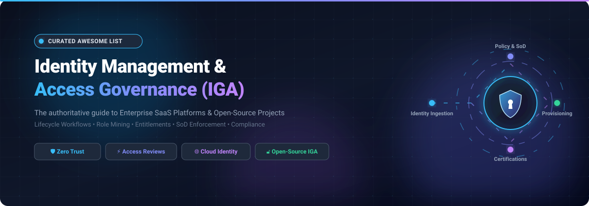

# Awesome-Identity-Management-Access-Governance 🛡️

<div align="center">

<p align="center">
  
</p>

# 🔐 Top Identity Management & Access Governance (IGA)

**A Curated Directory of Enterprise SaaS Solutions, Cloud Identity Platforms & Open-Source Projects**

<p align="center">
  <a href="https://github.com/ishandutta2007/Awesome-Awesome-Awesome"></a>
  <a href="https://discord.gg/jc4xtF58Ve"></a>
  <a href="https://github.com/ishandutta2007/Awesome-Identity-Management-Access-Governance/stargazers"></a>
  <a href="https://github.com/ishandutta2007/Awesome-Identity-Management-Access-Governance/network/members"></a>
  <a href="https://github.com/ishandutta2007/Awesome-Identity-Management-Access-Governance/issues"></a>
  <a href="https://github.com/ishandutta2007/Awesome-Identity-Management-Access-Governance/blob/main/LICENSE"></a>
  <a href="https://github.com/ishandutta2007"></a>
</p>

*Comprehensive guide covering Identity Governance and Administration (IGA), Access Governance, Identity Lifecycle Management, Entitlement Management, Role-Based Access Control (RBAC), Segregation of Duties (SoD), and Zero-Trust Compliance.*

**📅 Last updated: November 2026**

</div>

---

## 📌 Table of Contents

- [📖 Introduction & Overview](#-introduction--overview)
- [📊 Sector Overview & Market Dynamics](#-sector-overview--market-dynamics)
- [☁️ SaaS & Hosted Platforms](#️-saas--hosted-platforms)
- [🔓 Open-Source GitHub Projects](#-open-source-github-projects)
- [🏗️ Architectural Recommendations & Frameworks](#️-architectural-recommendations--frameworks)
- [📈 Star History](#--star-history)
- [🤝 How to Contribute](#-how-to-contribute)
- [💖 Support & Sponsorship](#-support--sponsorship)
- [⚖️ Disclaimer](#️-disclaimer)

---

## 📖 Introduction & Overview

Modern enterprise cybersecurity centers on identity as the primary security perimeter. This curated repository provides security architects, IAM engineers, compliance officers, and devops teams with an authoritative benchmark of **SaaS platforms** and **open-source identity projects** for **Identity Governance and Administration (IGA)** and **Access Management (IAM)**.

These systems empower organizations to:
- 🔄 Automate employee, contractor, and machine identity onboarding, role transitions, and offboarding (JML workflows).
- 📜 Enforce Least Privilege and perform scheduled access reviews, certifications, and attestations.
- ⚠️ Detect and remediate toxic combinations and Segregation-of-Duties (SoD) violations.
- 🛡️ Maintain continuous compliance with SOC 2, ISO 27001, HIPAA, GDPR, NIS2, and DORA frameworks across multi-cloud and hybrid infrastructures.

---

## 📊 Sector Overview & Market Dynamics

The global Identity Governance and Administration (IGA) sector is valued at approximately **$8.5 billion to $9.7 billion**, compounding rapidly at a **CAGR of 13.5%–15.2%** toward an anticipated **$28+ billion to $35 billion** footprint over the next decade. 

In terms of competitive concentration:
- **Enterprise Core (Moderately Concentrated):** The mission-critical enterprise tier remains moderately concentrated, dominated by established vendors like Microsoft, SailPoint, Okta, Saviynt, and CyberArk who hold significant market share for multi-system compliance and Fortune 500 rollouts.
- **Mid-Market & Cloud-Native (Highly Fragmented):** Outside legacy enterprise suites, the sector is increasingly fragmented. The proliferation of non-human identities (AI agents, service accounts, CI/CD pipelines), API-driven microservices, and specialized Identity Threat Detection & Response (ITDR) tooling has enabled nimble cloud-native players and self-hosted open-source stacks to capture substantial ground.

---

## ☁️ SaaS & Hosted Platforms

The following hosted enterprise platforms are ranked descending by company size (valuation / market capitalization / revenue):

| Platform | Description | Valuation / Revenue (Company Size) | Starting Pricing | Free Tier / Free Trial Limits |
| :--- | :--- | :--- | :--- | :--- |
| **[Microsoft Entra ID Governance](https://www.microsoft.com/en-us/security/business/identity-access/microsoft-entra-id-governance)** | Microsoft's enterprise identity governance suite offering automated access reviews, entitlement packages, lifecycle workflows, and PIM. | **~$3.85 Trillion** Market Cap (~$90B+ quarterly revenue) | **$7.00/user/month** (standalone add-on, annual commitment) or $12.00/user/month in Entra Suite | **30-day free trial** (up to 100 licenses for evaluation across Microsoft 365 / Azure tenants) |
| **[Okta](https://www.okta.com/)** | Cloud identity platform providing workforce identity, lifecycle management, access requests, and governance certifications alongside SSO. | **~$32 Billion** Market Cap (~$2.92B annual revenue) | **$17.00/user/month** (Workforce Identity Essentials tier including Access Governance; $1,500/year minimum) | **30-day free trial** (Workforce Identity sandbox, full feature access, no credit card required) |
| **[CyberArk](https://www.cyberark.com/)** | Identity security powerhouse known for privileged access management (PAM), workforce identity management, and secrets governance. | **~$20.6 Billion** Market Cap (~$1.36B annual revenue) | **$8.10/user/month** (Workforce Identity base tier; PAM typically $600–$1,500/user/year) | **30-day free trial** (Workforce Identity sandbox environment available via sales/AWS Marketplace) |
| **[Zoho Identity / Directory](https://www.zoho.com/)** | Workforce identity, single sign-on (SSO), and centralized directory management platform within the Zoho cloud ecosystem. | **~$12.5 Billion** Est. Valuation (~$1.5B annual revenue) | **$2.00/user/month** ($1.70/user/month billed annually for Standard Plan; Professional at $7.00/user/month) | **Forever Free Plan**: Free up to **10 users**, unlimited Zoho apps, 3 third-party SSO apps, 10 devices, and 2 directory stores |
| **[SailPoint](https://www.sailpoint.com/)** | Dedicated Identity Governance and Administration (IGA) platform featuring AI-driven access modeling, role mining, and certifications. | **$6.9 Billion** Acquisition Valuation (~$786M annual revenue) | **$5.00/identity/month** (~$60/identity/year baseline for Standard suite; ~$75,000 annual minimum) | **No self-service free trial** (Guided 30-day Proof of Concept / sandbox available via sales consultation) |
| **[One Identity](https://www.oneidentity.com/)** | Unified identity security portfolio covering IGA (One Identity Manager), privileged access, and Active Directory lifecycle management. | **~$5.4 Billion** Parent Transaction (Part of Quest Software, ~$1B+ group revenue) | **$2.50/user/month** (~$30/user/year baseline starting license via GSA/reseller schedules) | **30-day free trial** (Virtual Trial environment and 30-day evaluation available via sales request) |
| **[Saviynt](https://saviynt.com/)** | Cloud-native converged identity platform delivering cloud IGA, application access governance, PAM, and non-human identity security. | **~$3.0 Billion** Valuation ($700M Series B, scaling to $300M+ ARR) | **$2.00/user/month** (~$24/user/year starting tier for core cloud IGA subscriptions) | **30-day free trial** (Available specifically for Saviynt Zuma non-human/AI governance; sandbox PoC via sales) |
| **[Ping Identity](https://www.pingidentity.com/)** | Enterprise workforce and customer identity platform delivering access federation, intelligent MFA, and identity governance. | **$2.8 Billion** Acquisition Valuation (~$800M combined ARR post-merger) | **$3.00/user/month** (PingOne Essential tier; Plus tier with advanced governance at $6.00/user/month) | **30-day free trial** (Up to 1,000 active identities and 5 environments in PingOne sandbox) |
| **[ForgeRock](https://www.forgerock.com/)** | Comprehensive identity platform covering access management, identity governance, directory services, and identity gateways. | **$2.3 Billion** Acquisition Valuation (Merged into Ping Identity by Thoma Bravo) | **$3.00/user/month** (Standard Identity Cloud tier; $6.00/user/month for advanced orchestration) | **30-day free trial** (Integrated PingOne/ForgeRock Cloud sandbox supporting up to 1,000 active identities) |
| **[Omada](https://www.omadaidentity.com/)** | Enterprise IGA platform for automated identity lifecycle management, access certifications, and compliance workflows. | **~$150 Million** Valuation (~DKK 1B transaction in 2025; ~DKK 349M / ~$50M annual revenue) | **$25,000/month** (~$300,000/year enterprise deployment baseline for Omada Identity Cloud) | **No self-service free trial** (Structured 30-day PoC environment available via enterprise scoping & sales) |

---

## 🔓 Open-Source GitHub Projects

Open-source identity and governance projects provide transparent code, community auditing, self-hosted deployment flexibility, and freedom from proprietary per-identity SaaS licensing.

The following projects are sorted descending by their GitHub stargazers count:

| Project | GitHub_Stars | Focus Area | Description |
| :--- | :---: | :--- | :--- |
| **[Keycloak](https://github.com/keycloak/keycloak)** | [](https://github.com/keycloak/keycloak/stargazers) | IAM / IdP / Federation | Industry standard open-source Identity and Access Management server providing OpenID Connect, OAuth 2.0, SAML 2.0, user federation (LDAP/AD), fine-grained authorization policies, and identity brokering. |
| **[Authelia](https://github.com/authelia/authelia)** | [](https://github.com/authelia/authelia/stargazers) | SSO / Reverse Proxy Auth | Lightweight, open-source authentication and authorization server providing two-factor authentication and single sign-on (SSO) integration for reverse proxies (Nginx, Traefik, Caddy). |
| **[authentik](https://github.com/goauthentik/authentik)** | [](https://github.com/goauthentik/authentik/stargazers) | IdP / Governance-Adjacent | Versatile open-source identity provider emphasizing flexibility, user onboarding flows, policy-driven stage engines, directory synchronization, and custom access governance rules. |
| **[Ory Hydra](https://github.com/ory/hydra)** | [](https://github.com/ory/hydra/stargazers) | OAuth2 / OIDC Engine | Hardened, headless, cloud-native OAuth 2.0 and OpenID Connect provider capable of securing modern architectures and mediating high-throughput API access tokens. |
| **[ZITADEL](https://github.com/zitadel/zitadel)** | [](https://github.com/zitadel/zitadel/stargazers) | Cloud Identity / Multi-Tenant | Turnkey, cloud-native identity platform written in Go with audit-ready event modeling, multi-tenancy support, self-service portals, and granular RBAC authorization. |
| **[Casdoor](https://github.com/casdoor/casdoor)** | [](https://github.com/casdoor/casdoor/stargazers) | IAM / SSO Platform | UI-first identity and access management platform based on Casbin, delivering web UI administration, OAuth 2.0/OIDC, SAML, WebAuthn, and cross-application RBAC. |
| **[Ory Kratos](https://github.com/ory/kratos)** | [](https://github.com/ory/kratos/stargazers) | Headless Identity / IAM | Cloud-native, headless user identity and user lifecycle management system providing robust session management, MFA, account recovery, and customizable profile schemas. |
| **[Dex IdP](https://github.com/dexidp/dex)** | [](https://github.com/dexidp/dex/stargazers) | Identity Federation Broker | Federated OpenID Connect and OAuth 2.0 broker that connects application workloads to existing identity providers like LDAP, SAML, GitHub, Google, and Active Directory. |
| **[Kanidm](https://github.com/kanidm/kanidm)** | [](https://github.com/kanidm/kanidm/stargazers) | Directory & Auth Engine | Modern, memory-safe identity management platform written in Rust, combining fast directory service capabilities, OAuth2/OIDC, RADIUS, and passwordless authentication. |
| **[FreeIPA](https://github.com/freeipa/freeipa)** | [](https://github.com/freeipa/freeipa/stargazers) | Domain Identity & Policy | Centralized identity management solution for Linux and Unix environments combining 389 Directory Server (LDAP), MIT Kerberos, Dogtag PKI, NTP, and host-based access control (HBAC). |
| **[Samba](https://github.com/samba-team/samba)** | [](https://github.com/samba-team/samba/stargazers) | Active Directory Controller | Free software re-implementation of the SMB networking protocol providing full Active Directory Domain Controller (AD DC) compatibility and domain identity management. |
| **[WSO2 Identity Server](https://github.com/wso2/product-is)** | [](https://github.com/wso2/product-is/stargazers) | Enterprise IAM & Provisioning | API-driven enterprise IAM platform supporting SCIM-based provisioning, identity federation, adaptive access authentication, customer IAM, and fine-grained entitlement evaluation. |
| **[Janssen Project](https://github.com/JanssenProject/jans)** | [](https://github.com/JanssenProject/jans/stargazers) | Enterprise IdP / FIDO2 | High-performance open-source identity and access management platform from Gluu, built for hyperscale digital identity, OpenID Connect, and passwordless security. |
| **[midPoint](https://github.com/Evolveum/midpoint)** | [](https://github.com/Evolveum/midpoint/stargazers) | Comprehensive IGA Platform | The leading open-source Identity Governance and Administration (IGA) solution worldwide. Offers complete identity lifecycle provisioning, automated role mining, access certification campaigns, organizational hierarchy mapping, and compliance auditing. |
| **[Apache Syncope](https://github.com/apache/syncope)** | [](https://github.com/apache/syncope/stargazers) | Enterprise IGA & Provisioning | Top-level Apache project for managing digital identities in enterprise environments, offering identity provisioning, role-based reconciliation, workflow automation, and custom access control. |
| **[OpenIAM Community](https://github.com/rnkrsoft/OpenIAM)** | [](https://github.com/rnkrsoft/OpenIAM/stargazers) | Converged IAM & IGA | Open-source foundation for unified identity governance, web access management, and automated provisioning across enterprise infrastructure. |

---

## 🏗️ Architectural Recommendations & Frameworks

When architecting a comprehensive, production-grade identity stack without commercial licensing lock-in:

```
+-----------------------------------------------------------------------------------+
|                        ACCESS REVIEW & GOVERNANCE LAYER                           |
|      midPoint (Central IGA Engine: Access Certifications, Role Mining, SoD)       |
+-----------------------------------------------------------------------------------+
                                        |
                   +--------------------+--------------------+
                   |                                         |
                   v                                         v
+-------------------------------------+   +-------------------------------------+
|        AUTHENTICATION & FEDERATION  |   |    AUTHORITATIVE DIRECTORY & OS     |
|   Keycloak / authentik / ZITADEL    |   |         FreeIPA / Samba AD          |
|    (SSO, MFA, SAML, OIDC Broker)    |   |     (LDAP, Kerberos, Unix HBAC)     |
+-------------------------------------+   +-------------------------------------+
                   |                                         |
                   +--------------------+--------------------+
                                        |
                                        v
+-----------------------------------------------------------------------------------+
|                           APPLICATION INTEGRATION LAYER                           |
|       Ory Kratos / Hydra & Dex (Microservice Tokens, SCIM 2.0 Connectors)         |
+-----------------------------------------------------------------------------------+
```

- **IGA Core**: Deploy **midPoint** as the primary governance brain for identity lifecycle management, policy orchestration, and access certifications.
- **SSO & Authentication**: Pair with **Keycloak**, **authentik**, or **ZITADEL** for single sign-on, identity brokering, MFA, and user-facing authentication flows.
- **Directory Foundations**: Leverage **FreeIPA** (Linux) or **Samba AD** for system-level directory, Kerberos authentication, and machine identity control.
- **Microservices**: Integrate **Ory (Hydra/Kratos)** or **Dex** for lightweight OIDC token issuance and decoupled API access tokens.

---

## 📈  Star History

[](https://www.star-history.com/#ishandutta2007/Awesome-Identity-Management-Access-Governance&type=date&legend=top-left)

---

## 🤝 How to Contribute

Contributions are welcome and appreciated! To add a new platform or update existing entries:

1. 🍴 **Fork** this repository.
2. 🌿 **Create a new branch**: `git checkout -b feature/add-identity-tool`.
3. ✏️ **Edit `README.md`**: Follow existing table and formatting standards. Ensure pricing and repository Stars_Counts are verified.
4. 💾 **Commit your changes**: `git commit -m "Add [Tool Name] to IGA list"`.
5. 🚀 **Push to your branch**: `git push origin feature/add-identity-tool`.
6. 📬 **Submit a Pull Request** with a brief summary of why the tool is suitable.

---

## 💖 Support & Sponsorship

If this curated repository helped you design your identity governance architecture, choose an IGA provider, or build a secure compliance framework, please consider supporting the project!

- ⭐ **Star this repository** to improve discoverability on GitHub.
- 🍴 **Fork and share** with colleagues, IAM architects, and DevOps communities.
- ☕ **Sponsor the Maintainer**: Support ongoing curation, research, and maintenance via the **[GitHub Sponsor Dashboard](https://github.com/sponsors/ishandutta2007)**.

<p align="center">
  <a href="https://github.com/sponsors/ishandutta2007">
    
  </a>
</p>

---

## ⚖️ Disclaimer

- This directory is a **community-curated index** created for educational, research, and technical evaluation purposes.
- Mentions of products, trademarks, and logos belong to their respective owners and do not constitute an endorsement.
- Identity Governance directly impacts corporate cybersecurity posture, zero trust boundaries, and regulatory compliance. Always perform formal security reviews and proof-of-concept testing before deploying IAM/IGA systems to production.

---

<p align="center">
  <b>Crafted with ❤️ for identity security engineers, IAM architects, and open-source advocates.</b><br/>
  <sub>Keep access governance transparent, automated, and strictly under your control.</sub>
</p>
